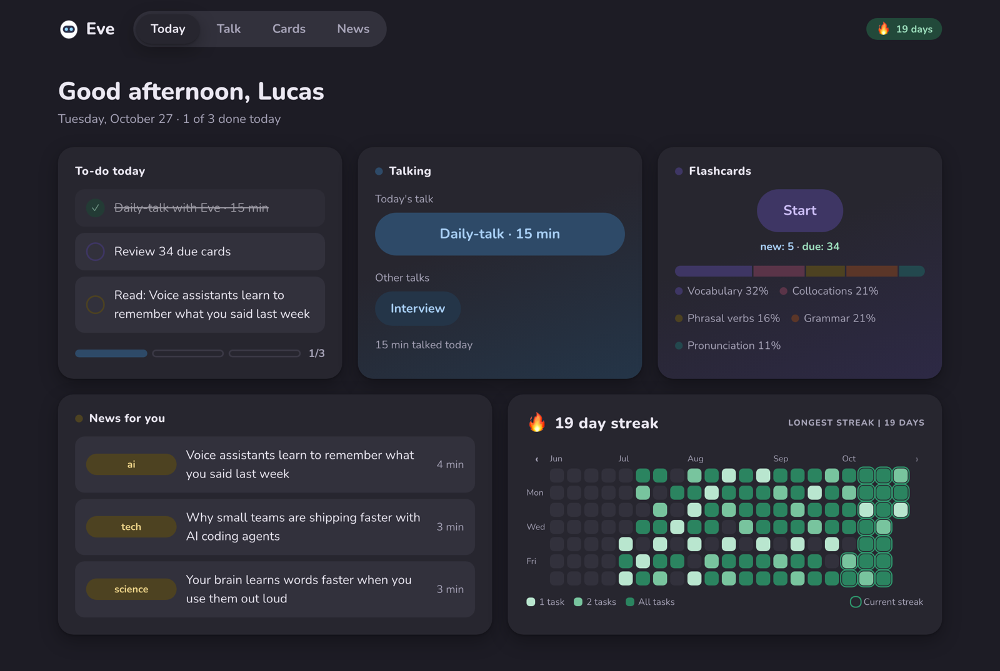
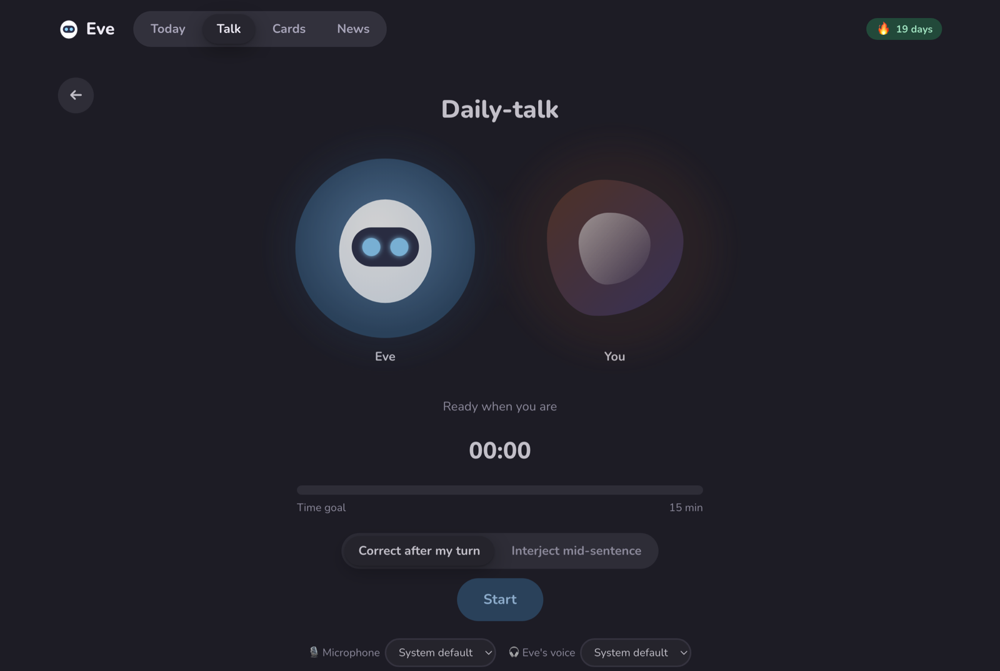
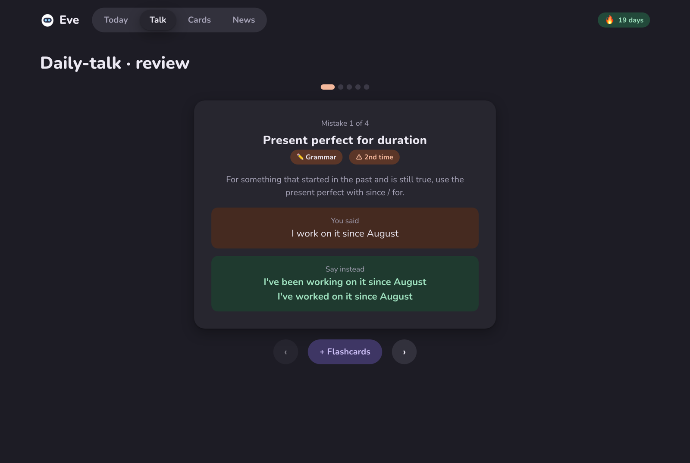
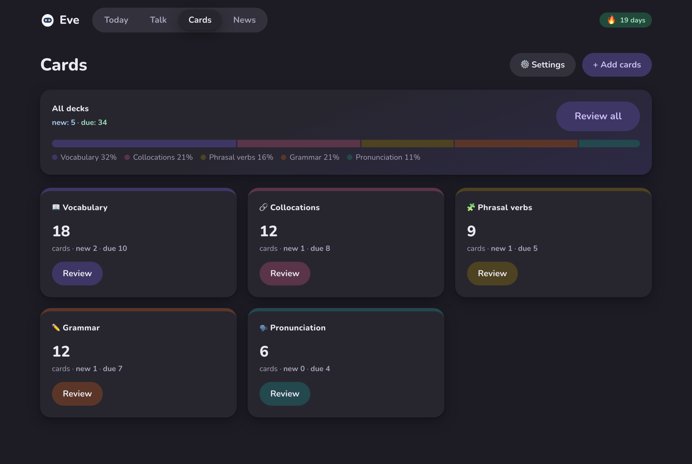
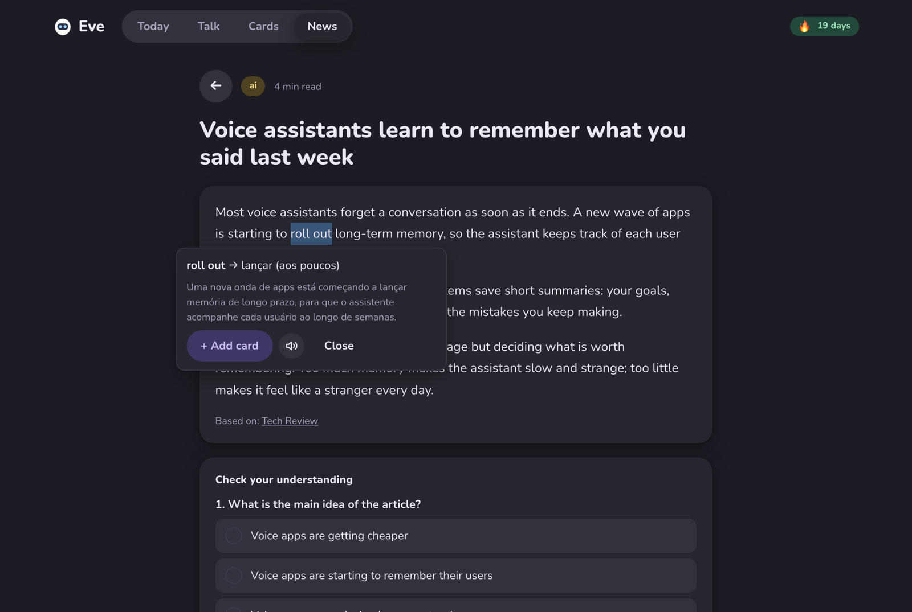
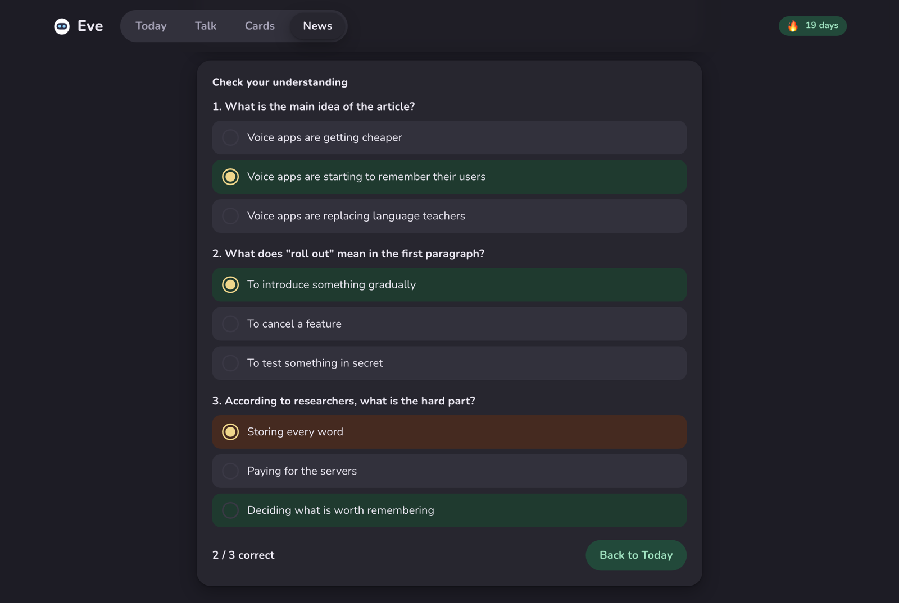
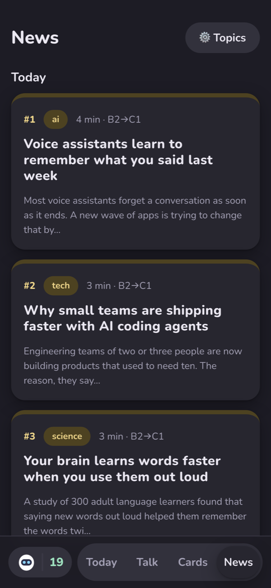
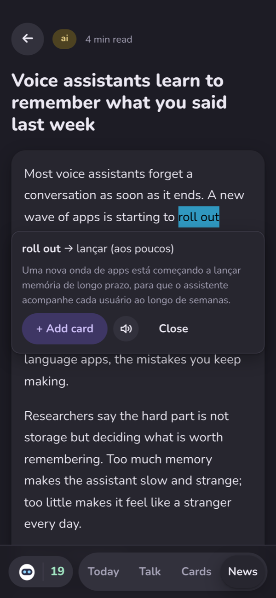
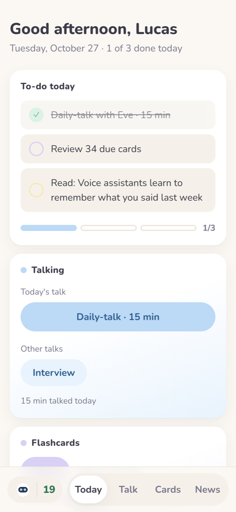

<div align="center">


# Eve

**A voice tutor that keeps track of your mistakes.**

You talk to Eve out loud and she corrects you as you speak. When the talk ends, a reviewer reads the transcript,
stores every mistake and counts it across sessions, so a mistake you keep making shows up as a repeat and turns
into flashcards.



</div>

## The loop

Most voice-chat tutors keep no record once the call ends. Eve is built around one loop: **talk → review →
cards**, with each step feeding the next.

### 1. Talk

A real-time, full-duplex voice conversation (OpenAI `gpt-live-1` over WebRTC). Eve corrects clear mistakes as they
happen, either after your turn or mid-sentence, as you choose. Pick a free daily talk or a mock job interview.
The live conversation doesn't know your mistake history: that memory lives in the review step.



### 2. Review

When you end the talk, a second model reads the whole transcript and pulls out every real mistake. It gets your
past mistakes too, so it files a repeat under the same rule and Eve counts it. You see only the few that matter
most, ranked by severity and by **how many times you've made them before**.



### 3. Cards

One tap turns a mistake into flashcards, scheduled with FSRS spaced repetition. There are five card designs:
vocabulary, collocations, phrasal verbs, grammar fixes and pronunciation. Cards also come from an Anki import,
from [text you select](#select-anything-translate-it-hear-it-card-it) anywhere in the app, and from other tools through a [webhook](#connecting-other-apps-the-inbox-webhook-and-eve-add).



## Select anything: translate it, hear it, card it

Select a word or an expression anywhere in Eve, whether in an article, a card or a review, and two buttons appear:

- **Translate:** the selection goes to DeepL **together with the sentence around it**, so you get the meaning it
  has *here*, not the dictionary's first entry. You also see the translation of the whole sentence.
- **🔊 Listen:** hear the selection read aloud. Audio is made only when you tap, and it's cached, so the second
  time plays at once. If the voice service fails, the browser's own voice reads it instead.
- **+ Add card:** Eve's card engine writes the flashcard for you, again using the sentence as context. If the
  word is part of a larger collocation or phrasal verb, it can card that instead (select *roll* in "roll out
  memory" and the card may be for *roll out*). The card is saved in the background while you keep reading.



## News: a daily edition written for your level

Reading is the third habit Eve tracks, and its texts are written for you. Every morning at 7:00 Eve publishes an
edition of **up to 5 short articles** on the topics you follow. Each one is a real story from the last 24 hours,
rewritten at B2→C1 level and followed by a short reading test.

How an edition is made:

1. **Collect.** Eve reads the Google News RSS feed for each topic you follow (World, Brazil, Tech, AI & software,
   Science, Business, Health, Sports, Culture) and the Hacker News front page for AI & software. Stories are ranked
   by Google's own ordering, by how many outlets cover them, and by whether they also make the day's top stories.
   No API key is needed for this step.
2. **Edit.** One small model call acts as the front-page editor and picks the stories. It puts importance first and
   keeps the edition varied: at most 2 stories per topic, never two on the same event, and nothing already covered
   recently. Gossip, clickbait, deals, game patches and listicles are left out.
3. **Write.** For each pick, a model with web search finds the story at an open, reputable outlet published in the
   last 2 days, reads one or two sources, and writes an **original** 130–180-word article in American English. It
   uses mostly B2 language plus 2–3 useful C1 collocations or phrasal verbs, and adds **3 comprehension
   questions** that test understanding rather than trivia.
4. **Check.** An article is dropped if it's too short, or if its source link isn't a page the search actually
   returned, so an invented URL never reaches you. Each article links to its source once, at the end.



You pick the topics in News → Topics. Each edition costs one editor call plus one web-search-backed writer call
per article, all logged in `api_usage`. Google News feeds are meant for personal, non-commercial reading, which is
what Eve does with them.

## On your phone

Eve installs as a home-screen app. It follows your system's light or dark setting, and tapping Eve's icon switches
it. The screenshots above use night mode; the last one below shows the light theme.

<p align="center">
  
  &nbsp;
  
  &nbsp;
  
</p>

<sub>Screenshots use a demo database.</sub>

## Why it exists

I'm a Brazilian developer going from B2 to C1 English. Speaking with someone in real time was the gap that
flashcards and videos couldn't close, and the voice modes I tried forgot the conversation after a few minutes. I
built Eve over a weekend and I use it every day.

It's published as a **reference implementation**: run it, read it, fork it. It is not a hosted product, and I
don't offer support.

## Architecture

```
browser ──WebRTC──▶ OpenAI gpt-live-1            (live talk; the server only creates the session)
   │
   └──/api──▶ Node server (127.0.0.1:8790) ──▶ OpenAI Responses API (evaluator, card engine, news + web search)
                   │                       ├──▶ DeepL (translate a selection)
                   │                       └──▶ Google News RSS + Hacker News (news candidates)
                   └──▶ SQLite (data/eve.db): cards, review log, talks, transcripts, mistakes, usage
```

The talk has three roles, each handled by a different part of the system: the realtime model handles the
conversation, the transcript is stored, and an analyst model reviews it afterwards. The realtime model is good at
talking, but it forgets and is expensive per minute. The evaluator is cheap and sees your mistake history, so the
memory lives there instead of in the live session.

- **Server:** plain Node 22 + TypeScript run through Node's type stripping (no build step), `node:http`, and the
  built-in `node:sqlite`. No framework and no ORM.
- **Web:** React 19 + TypeScript + Vite, with a phone layout and an installable home-screen app.
- **Spend tracking:** every paid call is recorded in an `api_usage` table, and `GET /api/usage` shows the totals.
  Talk is the expensive part, at about US$0.05/min (30 min/day ≈ US$45/month). Reviews and cards cost cents.

## Running it

Requires Node ≥ 22.9, an OpenAI API key with access to `gpt-live-1`, and optionally a DeepL API key (the free plan is enough).

```bash
npm install
cp .env.example .env    # then fill in your keys (see below)
npm run dev             # API server + Vite → http://127.0.0.1:5173
```

`.env`:

```bash
OPENAI_BASE_URL=https://api.openai.com/v1
OPENAI_API_KEY=sk-...
DEEPL_BASE_URL=https://api-free.deepl.com/v2   # optional
DEEPL_API_KEY=...                              # optional
TZ=America/Sao_Paulo                           # days, streaks and the news edition use local time
```

On my machine the server never holds a key: it calls a local key broker that injects the key, which is why the
defaults in `server/openai.ts` and `server/deepl.ts` point to `127.0.0.1:8787`. Setting the two `*_BASE_URL`
variables bypasses the broker.

Production mode is a single process: `npm run build`, then `npm start`. Other settings: `EVE_PORT` (default 8790),
`EVE_DB` (database path), `EVE_ORIGINS` (extra allowed page origins, comma-separated, e.g. to reach Eve from
your phone over a private network) and `EVE_NEWS_SCHEDULE=off`. I keep Eve always on as a macOS LaunchDaemon
reached over Tailscale. Any process supervisor that runs `npm start` works the same way.

**Make it yours.** The prompts describe me: a Brazilian developer learning American English, with Portuguese
hints on the cards. Edit `server/prompts/tutor.ts` (the tutor), `server/llm/evaluator.ts` (the review) and
`server/llm/engine.ts` (the cards) and `server/lib/news-llm.ts` (the news editor and writer) for your own native
language and level, and the greeting name in `web/src/pages/Home.tsx`. News topics and their feeds live in
`server/lib/news-sources.ts`, and DeepL's target language in `server/deepl.ts`.

## Connecting other apps: the inbox webhook and `eve-add`

Eve has no plugin system. It has a single HTTP endpoint that any local tool can call to send cards in:

```
POST http://127.0.0.1:8790/api/inbox/cards
```

It accepts two shapes:

```bash
# 1. Finished cards: free, validated, stored as-is
curl -s localhost:8790/api/inbox/cards -H 'Content-Type: application/json' -d '{
  "cards": [
    { "word": "auction", "back": "a public sale where things go to the highest bidder" },
    { "kind": "collocation", "front": "We need to ___ concerns about the deadline.", "back": "<b>raise</b> concerns about" }
  ]
}'

# 2. Raw items: Eve's card engine writes the cards (one paid model call)
curl -s localhost:8790/api/inbox/cards -H 'Content-Type: application/json' \
  -d '{ "text": "fix: I were there → I was there\nword: auction\npv: pull off" }'
```

Card kinds are `word` (default), `collocation`, `phrasal` (needs a kebab-case `pv`), `fix` and `pronunciation`
(both need a kebab-case `rule`). A fix is always 3 consecutive cards with the same `rule`, a phrasal sense 2 and a
pronunciation item 2. Eve shows the cards of one rule on different days, and the reply tells you how many times
that rule has been carded, so recurring mistakes show up as recurring. Exact duplicates are skipped, so sending
the same batch twice does nothing, and `"dryRun": true` validates without saving.

**`eve-add`** ([`skills/eve-add/`](skills/eve-add/)) is the client I actually use: a Claude Code skill. While I work with an AI agent in English all day,
the agent corrects my English at the end of its replies. When I type `/eve-add`, it turns those corrections, or any
word, collocation or phrasal verb I give it, into cards in the right design and posts them to the webhook. I never
leave the terminal, and the mistakes I make outside Eve end up in the same review queue as the ones I make in
it. Any tool works the same way: a browser extension, a reading app or a shortcut on your phone only needs to
send JSON to that endpoint.

Like every route, the webhook only accepts local requests: the server listens on `127.0.0.1` and refuses browser
pages from other origins.

## Layout

```
server/            Node API: routes/ (one file per module), lib/, llm/ (evaluator, card engine), prompts/
web/               React app: pages/, live/ (WebRTC client), data/ (API + state)
skills/eve-add/    Claude Code skill that sends cards to the inbox webhook (copy it into .claude/skills/)
harness/           the model-comparison page used to pick the live-talk model (historical)
tts/               local Kokoro TTS sidecar (no longer used: its pronunciation was too poor)
```

## Caveats

- 🔊 Listen uses Google Translate's unofficial TTS endpoint. That's fine for personal use but not for a product, and it can stop working at any time.
- Eve has a single user and no authentication. Keep it on localhost or a private network.
- Model names and prices reflect October 2026.

## License

MIT. See [LICENSE](LICENSE).
